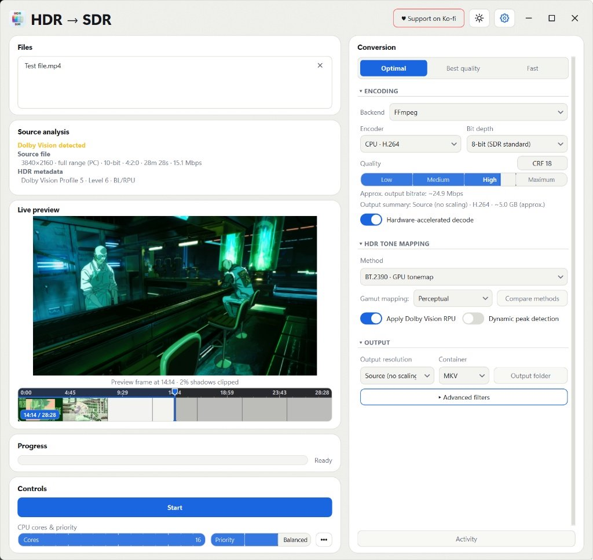
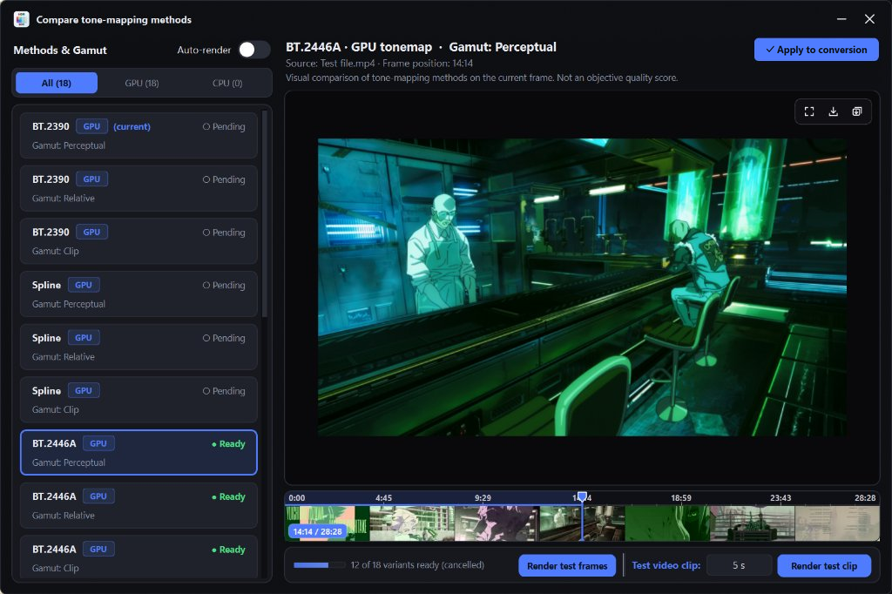

# HDR to SDR Video Converter

A desktop tone-mapping tool — standard FFmpeg, true BT.2390 on the GPU, or HandBrakeCLI, with the exact command always visible. H.264, H.265, and AV1 output, 10-bit and 12-bit included, visual side-by-side tone-mapping comparison, free.


**[Website](https://openhdrtosdr.com/)** · **[Latest release](https://github.com/devgodys/HDR-to-SDR-Video-Converter/releases/latest)**



## Why

If you're just a user who wants to convert HDR to SDR, you shouldn't have to learn FFmpeg first.

Right now the choice is usually one of two extremes: paid software with a clean interface, or FFmpeg/HandBrake — free, powerful, and correct, but built for people who already know what BT.2390 means and are comfortable on a command line. There's not much in between.

This app is built to be that middle ground. It does exactly one job — HDR to SDR — and does it using nothing but your own hardware and open-source tools already capable of doing it right (FFmpeg, libplacebo/Vulkan, optionally HandBrakeCLI). No subscription, no cloud processing, no black-box "auto" button standing in for a real answer. Just a normal window: pick a curve (or compare all 18 visually on a frame from your video), pick an encoder, hit start, and see the exact command that ran.

## Backends

Three genuinely different pipelines, not one "auto" button:

| Backend | Type | Curves | Notes |
|---|---|---|---|
| **Standard FFmpeg** | CPU (`zscale` + `tonemap`) | Hable, Reinhard, Mobius (+ Linear, Gamma, Clip, None in Pro mode) | Fast, works everywhere FFmpeg does, no GPU required |
| **libplacebo / Vulkan** | GPU | BT.2390 by default; BT.2446A, Spline, ST2094-10, ST2094-40 (HDR10+), Hable, Reinhard, Mobius, Linear, Gamma, Clip in Pro mode | Runs the real ITU-R BT.2390 EETF, ITU-R BT.2446 Method A, and dynamic metadata curves on Vulkan — plus perceptual, relative, saturation, and clip gamut mapping |
| **HandBrakeCLI** | Experimental | Hable / Reinhard / BT.2390 via HandBrake's pipeline | Alternate encode path with matching resolution, encoder, filter, and track controls |

## Visual Tone-Mapping Comparison

Not sure whether **BT.2390**, **BT.2446A**, **Spline**, **Hable**, **Mobius**, or **Reinhard** looks best on a dark or high-nit scene? Open **Compare tone-mapping methods** straight from the Live Preview card:



- **Up to 18 method × gamut combinations** — compare GPU (`libplacebo`) and CPU (`zscale`) curves alongside **Perceptual**, **Relative**, and **Clip** gamut mapping modes on the exact same source frame.
- **Interactive timeline frame strip** — scrub to any timestamp or pick a thumbnail along the video timeline to test bright highlights, skin tones, or dark interiors.
- **5-second test video clips** — render a 5-second motion clip right from the comparison window (or main window) using your exact encoder and filter settings before committing to a full-length encode.
- **One-click apply** — click **✓ Apply to conversion** to immediately lock in the winning backend, curve, and gamut mode.

## Features

- **True BT.2390 & BT.2446A tone mapping** via `libplacebo`/Vulkan — not a CPU approximation
- **Dolby Vision & HDR10+ aware** — detects Dolby Vision (Profile 5, Profile 7, Profile 8) and HDR10+ dynamic metadata during analysis, warns when Profile 5 requires `libplacebo` (no HDR10 base layer), and supports `ST2094-40` / `ST2094-10` dynamic tone-mapping curves
- **H.264, H.265 and AV1 output** — CPU (`libx264` / `libx265` / `libsvtav1`) plus hardware encoders (**NVIDIA NVENC**, **AMD AMF**, **Intel QSV**, and **Apple VideoToolbox**). AV1 is royalty-free and typically needs 40–50% fewer bits than H.264 for comparable quality
- **10-bit & 12-bit output** — free, no license, no separate build. 10-bit works with any H.265/AV1 encoder (CPU or hardware) and 10-bit H.264 (`high10`); 12-bit is CPU `libx265` only
- **Compare tone-mapping methods dialog** — side-by-side frame renderer across all GPU and CPU curves, gamut mapping modes, timeline scrubbing, and 5-second test clip rendering
- **Fine colour & image controls (Pro mode)** — interactive **2D Brightness × Saturation pad**, **Colour temperature** slider (Cool ↔ Warm), **Denoise** (`hqdn3d` / `nlmeans`), **Deband** (`gradfun` for 8-bit skies), **Sharpen** (`unsharp`), **10-bit HDR Auto-crop** (accurate black-bar detection), and **Subtitle burn-in**
- **Batch queue & crash-safe resume** — queue any number of videos via picker or drag-and-drop; interrupted conversions are tracked automatically so you can **Resume** from the last completed keyframe segment instead of starting over from 0%
- **One-click presets** — once a queued video is analyzed, apply **Optimal** (recommended curve for that source), **Best quality** (CPU · H.265, Pro mode, low CRF, best available curve), or **Fast** (hardware encoder if detected, else fast CPU preset)
- **Analyzes on demand** — transfer characteristics, primaries, mastering display nits (`MaxCLL` / `MaxFALL`), Dolby Vision profile, HDR10+ metadata, audio/subtitle streams, and a curve recommendation run on click or right before conversion starts
- **Smart audio & subtitle passthrough** — all audio and subtitle tracks are copied through untouched (`-c:a copy`, `-c:s copy`), with automatic MP4 `mov_text` → `SRT` conversion when outputting to `.mkv`
- **MP4 or MKV output container** — MP4 for universal device/browser playback, or MKV when the source carries PGS/ASS subtitles or lossless audio tracks that MP4 cannot mux as-is
- **Live Preview & clipping inspector** — real decoded-and-tone-mapped frame from your source with shadow/highlight clipping check, full-screen zoom viewer, clipboard copy, and PNG export
- **Live bitrate & disk-space estimate** — updates automatically as you change quality (CRF / CQ / target bitrate), resolution, or encoder, and checks free disk space before starting
- **Mini Mode** — collapse the app into a compact floating controller showing live progress, preview, queue controls, and pause/resume while keeping your desktop uncluttered
- **Theme Customizer** — **Light**, **Dark**, and **Neon** themes with custom gradient stops, background effects, and adjustable card/button rounding
- **31 interface languages** — auto-detects your system language or lets you switch live from the header globe menu (`i18n/*.json`)
- **Live run & power controls** — pause/resume mid-encode, live CPU-core affinity slider, process priority (Efficiency / Normal / High), and post-queue actions (Do nothing, Close app, Sleep, Shutdown)
- **One-click Windows setup** — missing FFmpeg or HandBrakeCLI can be installed via `winget` from inside the app, with an automatic SHA-256-verified portable download fallback when `winget` isn't available
- **Transparent by design** — the exact FFmpeg or HandBrakeCLI command line is always visible and copyable, never hidden behind a black box

## Requirements

| Component | Needed for |
|---|---|
| Python 3.10+ | Running the app from source (`Python 3.15` used for hash-locked stable builds) |
| PySide6 | The Qt 6 desktop UI |
| FFmpeg *(full/GPL build, with `libx264` + `libx265` + `libsvtav1` + `libplacebo`)* | Standard and GPU tone-mapping backends, plus AV1 output |
| Vulkan-capable GPU + drivers | The `libplacebo` / BT.2390 GPU backend specifically |
| HandBrakeCLI *(optional)* | The experimental HandBrake backend |
| psutil *(optional)* | Live pause/resume, CPU-core affinity control, and CPU/RAM stats |
| `i18n/` folder *(optional)* | 31 non-English interface languages — without it the app runs in English |

On Windows, missing FFmpeg/HandBrakeCLI can be installed automatically from inside the app via `winget` — see the System panel, or the **Quick install** shortcut in the header. If `winget` isn't available, the app downloads the official portable builds directly and verifies their SHA-256 checksums before unpacking. See [Dependencies & licensing](#dependencies--licensing) below for details.

## Dependencies & licensing

This app doesn't bundle FFmpeg or HandBrakeCLI — they're installed on your own machine, straight from their authors' official channels, via `winget` (or downloaded directly as a SHA-256-verified portable copy when `winget` isn't available):

| Tool | Source | winget package ID | License |
|---|---|---|---|
| FFmpeg | [gyan.dev](https://www.gyan.dev/ffmpeg/builds/) / [BtbN](https://github.com/BtbN/FFmpeg-Builds) full GPL build | `Gyan.FFmpeg` | GPLv3 |
| HandBrakeCLI | [HandBrake](https://handbrake.fr) official release | `HandBrake.HandBrake.CLI` | GPLv2 |

AV1 encoding uses SVT-AV1 (`libsvtav1`), which ships in the same FFmpeg full build above — BSD-2-Clause + Patent, part of the Alliance for Open Media's royalty-free AV1 ecosystem.

Both FFmpeg and HandBrake are independent open-source projects — full credit to their authors and contributors. This app is a GUI front end that shells out to them as separate processes; it doesn't modify, link against, or redistribute their code, and each keeps its own license regardless of this project's MIT license (see [License](#license) below).

Prefer to install them yourself instead of using the in-app installer? That works too — the app looks for `ffmpeg`, `ffprobe`, and `HandBrakeCLI` on your `PATH` (or lets you pick a custom binary path in the Conversion panel).

## Install & run

```bash
git clone https://github.com/devgodys/HDR-to-SDR-Video-Converter.git
cd HDR-to-SDR-Video-Converter
pip install -r requirements-latest.txt
python -m hdr2sdr
```

*(You can also launch via `python hdr_to_sdr_gui_qt.py` for backward compatibility, or use `pip install --require-hashes -r requirements.txt` on Python 3.15 for the hash-locked dependency channel — see [DEPENDENCIES.md](DEPENDENCIES.md).)*

Or grab a prebuilt standalone Windows `.exe` from the [latest release](https://github.com/devgodys/HDR-to-SDR-Video-Converter/releases/latest) — no Python required.

### 10-bit / 12-bit output

10-bit and 12-bit are built into the **Conversion** card as a bit-depth selector — no separate script or build. Picking a depth filters the encoder list down to whatever your FFmpeg/HandBrakeCLI build can actually produce at that depth (e.g. `libx265` for 12-bit, or 10-bit NVENC/AMF/QSV/CPU encoders), rather than offering combinations that don't exist. Free, no license needed.

## Project structure

```text
hdr2sdr/
├── __main__.py        # Entry point (python -m hdr2sdr)
├── core/              # Pure-Python domain logic (zero Qt dependencies):
│                      # FFmpeg/HandBrake command builders, stream probing,
│                      # Dolby Vision/HDR10+ analysis, track planning, auto-crop
├── runtime/           # Process management, hardware encoder probing,
│                      # portable tool installer, Windows power & job objects
├── services/          # Queue controller, resume coordinator, history & settings stores
├── theme/             # Design tokens, WCAG contrast math, Light/Dark/Neon/Glass QSS
└── ui/                # PySide6 windows, Compare tone-mapping dialog, Mini mode,
                       # custom glass/gradient widgets, and vector icons
```

## Basic workflow

1. **Add videos** to the queue — via the file picker or by dragging one or more files onto the window — and the **SDR output** path is filled in for each (next to the source by default, or in a single output folder you choose). Adding is instant; nothing is analyzed yet.
2. Select a queued file and click **Analyze** (or just start the queue — each file is analyzed automatically right before its turn) to read its transfer function, bit depth, color range, duration, mastering luminance, and HDR10+/Dolby Vision metadata, with a curve suggested based on what it finds.
3. Once analyzed, either use **Optimal** / **Best quality** / **Fast** to one-click apply a recommended curve/encoder/quality combo, or click **Compare methods** in Live Preview to visually inspect all 18 tone-mapping + gamut combinations on a real frame from your video.
4. Adjust **quality** (Simple presets or Pro CRF / CQ / target bitrate), **resolution**, **encoder** (H.264, H.265, or AV1), **bit depth** (8-bit, 10-bit, 12-bit), and **container** (MP4 or MKV). Optionally render a **5-second test clip** to preview motion and encoding speed before committing.
5. Click **Start queue** — each file converts in turn, with progress, speed, ETA, and live FFmpeg/HandBrake output shown as it runs. Pause/resume, CPU-core limits, and process priority can all be adjusted mid-conversion.

## Building a standalone executable

Windows only (this builds a single-file `.exe`). Ensure `icon.ico`, `icons/`, and `i18n/` are present in the repository root — all three get bundled automatically.

You can use the included [`Compilation.bat`](Compilation.bat) script:

```bat
Compilation.bat latest
```

*(Or `Compilation.bat stable` on Python 3.15 using the SHA-256 hash-locked dependency channel.)*

To build manually with `PyInstaller`:

```bat
pip install pyinstaller
```

Run as **one single line** in `cmd.exe` or PowerShell:

```bat
python -m PyInstaller --noconfirm --clean --noupx --windowed --onefile --name "HDR-to-SDR-Converter" --icon icon.ico --paths . --collect-submodules hdr2sdr --add-data "i18n;i18n" --add-data "icons;icons" --add-data "icon.ico;." hdr2sdr\__main__.py
```

Or across multiple lines in `cmd.exe` using `^`:

```bat
python -m PyInstaller --noconfirm --clean --noupx --windowed --onefile ^
  --name "HDR-to-SDR-Converter" ^
  --icon icon.ico ^
  --paths . ^
  --collect-submodules hdr2sdr ^
  --add-data "i18n;i18n" ^
  --add-data "icons;icons" ^
  --add-data "icon.ico;." ^
  hdr2sdr\__main__.py
```

## Running tests

The pure-Python `hdr2sdr/core/` layer and Qt UI components are covered by an automated `pytest` suite:

```bash
pip install pytest
QT_QPA_PLATFORM=offscreen python -m pytest tests/ -q
```

## Troubleshooting

- **BT.2390 (GPU) option greyed out** — no Vulkan-capable device was detected or your FFmpeg build lacks `libplacebo`; use a Standard FFmpeg curve instead, or install the full FFmpeg build via **Quick install**.
- **"Encoder unavailable" for CPU · H.264/H.265/AV1** — you likely have an LGPL/"essentials" FFmpeg build without `libx264`/`libx265`/`libsvtav1`. Use the in-app **Quick install** (installs the full GPL build automatically), or grab the "full" build from [gyan.dev](https://www.gyan.dev/ffmpeg/builds/).
- **Dolby Vision video looks purple/green on CPU backend** — Dolby Vision Profile 5 uses proprietary ICtCp reshaping without an HDR10 fallback layer; switch the backend to **GPU (`libplacebo`)**, which natively decodes Profile 5 reshaping metadata.
- **HandBrakeCLI backend missing** — it's optional and only appears once `HandBrakeCLI` is found on your `PATH` or installed via the in-app installer.
- **Conversion feels like it's taking over the machine** — drop Process priority to **Efficiency**, or lower the CPU-core count slider live during a run.

## Support

If this saved you a re-encode: [♥ Support on Ko-fi](https://ko-fi.com/devgodys)

## License

[MIT](LICENSE)
